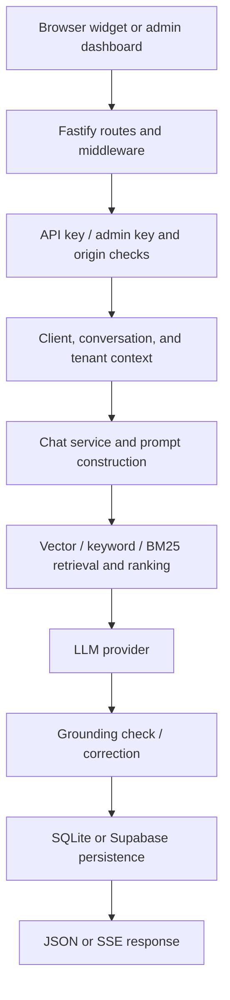
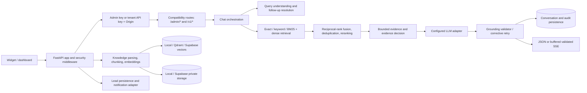

# Orbit AI — architecture and migration coverage

## Inspected source archives

| Project | Inspected layout | Key findings |
|---|---|---|
| `orbit-ai-main.zip` | Fastify / TypeScript API, React/Vite dashboard, `public/widget.js`, SQLite repository, local/Qdrant/Supabase providers, original RAG/grounding code, TypeScript tests | Tenant-scoped APIs and RAG already existed. The dashboard and widget should remain web assets; replacing them in Python would not be useful. |
| `advanced_rag-upgraded(1).zip` | Python `advanced_rag` package, query understanding, retrieval, ingestion, context, answering, memory, provider/config modules, tests | The reference suite passed 24 tests in the original extracted tree. Selected query-understanding logic is reused, while retrieval/grounding is implemented in Orbit AI's own request path. |

Full inventories taken before modification: `ORIGINAL_ORBIT_FILE_INVENTORY.txt` (93 files) and `ADVANCED_RAG_FILE_INVENTORY.txt` (44 files). The supplied zip archives were left unchanged. Archive entries were checked for unsafe extraction paths and symlinks before extraction; none were observed.

## Original Orbit AI request path (source-derived)

The original source had a connected advanced RAG service and grounding checks rather than requiring a new disconnected subsystem. Its dashboard source also calls conversation list/detail APIs; the Python port exposes both.

## Advanced RAG reference (verified source structure)

The reference package includes query understanding and multilingual follow-up handling, ingestion/chunking, retrieval/ranking, evidence/context processing, answering, conversation-memory and vector/provider modules. Its complete test suite was run as a baseline with 24 passed. The integrated path selects the reusable `QueryUnderstandingService` in offline rule/variant mode and preserves the Orbit tenant/storage contract; the reference app as a whole is not vendored as a second server.

## Final Python runtime architecture

## Production request-to-response sequence

1. Middleware applies request-size/rate controls, CORS behavior, and baseline security headers.
2. Public routes validate the hashed tenant API key, tenant enabled status, and an exact configured domain/Origin match; admin routes compare `X-Admin-API-Key` in constant time.
3. The service resolves the tenant and reads authorized persisted history for the same tenant/session.
4. Greetings/general responses can skip knowledge retrieval; factual requests run tenant-filtered vector retrieval plus exact, keyword and BM25 matching, RRF fusion, deduplication, reranking and evidence selection.
5. Short/follow-up or weak-evidence requests invoke the Advanced RAG-derived query understanding service to resolve likely context and generate variants; retrieval never merges another tenant's corpus.
6. The context is bounded and includes real source/chunk identifiers. Retrieved material is explicitly untrusted data in the LLM instruction.
7. The answer passes numeric/negative/qualification checks; an unsuccessful check triggers one corrective generation attempt, then the configured fallback when it still fails.
8. User and assistant messages plus usage are persisted before response. Streaming sends the fully validated answer as SSE token events, then a `done` event.

## API / feature compatibility matrix

| Feature or interface | Final Python implementation | Verification status |
|---|---|---|
| `/health`, `/ready`, `/metrics` | FastAPI routes | PASS locally with local providers |
| Admin authentication and tenant CRUD / key rotation | `/admin/auth/validate`, `/admin/clients/*` | PASS for exercised create/auth/list paths; all remaining admin paths are source-inspected but not individually exhaustively tested |
| Dashboard and `/widget.js` | Existing prebuilt static assets served from `public/`; `/` redirects to `/admin/` | PASS for local HTTP smoke tests |
| Public `/v1/config`, `/v1/chat` | API-key and Origin validation; persistent tenant chat | PASS local |
| Public `/v1/chat/stream` | Buffered grounded response emitted as SSE events | PASS local |
| Public `/v1/leads` | Tenant conversation ownership check, lead storage, notification adapter | Local validation and outbox pathways exercised only where noted in report; external SMTP/Supabase not verified |
| Document upload / list / delete / rebuild | TXT, MD, PDF, DOCX and CSV parsing; tenant-prefixed storage; chunk/index metadata | TXT upload, retrieval, list and source attribution PASS locally; PDF/DOCX parsing and external storage not exhaustively verified |
| SQLite / local files / local vector | Existing data-dir layout and schema compatibility columns | PASS with temporary local DB and restart test |
| Supabase repository / private storage / pgvector / outbox | HTTP/PostgREST/Storage adapters and checked-in SQL migration | Implemented; BLOCKED for real verification (no credentials/project access) |
| Qdrant, OpenAI-compatible embeddings / LLM, SMTP | Provider adapters, timeout/retry paths, health checks | Implemented; BLOCKED for real verification (no endpoint credentials/services) |
| React/Vite dashboard source | Retained in `dashboard/`; previously built assets retained | Bundle served locally; frontend rebuild NOT RUN because npm dependency cache is empty and package registry is not reachable in offline mode |
| Node backend | Removed from release runtime and source tree; no active Python route forwards to Node | PASS by final source/layout audit; legacy browser tooling remains Node-based only for frontend rebuilds |

## Relevant files

| File | Responsibility |
|---|---|
| `orbit_ai/app.py` | FastAPI app, middleware, admin/public routes, static UI and lifecycle |
| `orbit_ai/config.py` | Environment parsing, validation, compatibility aliases |
| `orbit_ai/security.py` | API-key generation/hash/constant-time comparison, domain and path normalization |
| `orbit_ai/db.py` | SQLite schema/repository and Supabase PostgREST repository |
| `orbit_ai/providers.py` | Embedding, vector, storage, LLM, and notification adapters |
| `orbit_ai/knowledge.py` | File parsing, chunking, ingestion, metadata and rebuild |
| `orbit_ai/rag.py` | BM25/keyword/exact retrieval, RRF, reranking, evidence and grounding checks |
| `orbit_ai/chat.py` | Persistent chat orchestration and query-understanding integration |
| `orbit_ai/integrations/query_understanding.py` | Integrated Advanced RAG query understanding component |
| `orbit_ai/models.py` | Strict Pydantic v2 request models |
| `supabase/migrations/0001_initial.sql` | Supabase schema, RLS, private bucket and `vector(128)` RPC |
| `supabase/migrations/0002_restrict_audit_logs.sql` | Tightens tenant-bound audit-log row-level security |
| `supabase/migrations/0003_atomic_domain_replacement.sql` | Adds transactional tenant domain allowlist replacement RPC; application against live Supabase not verified |
